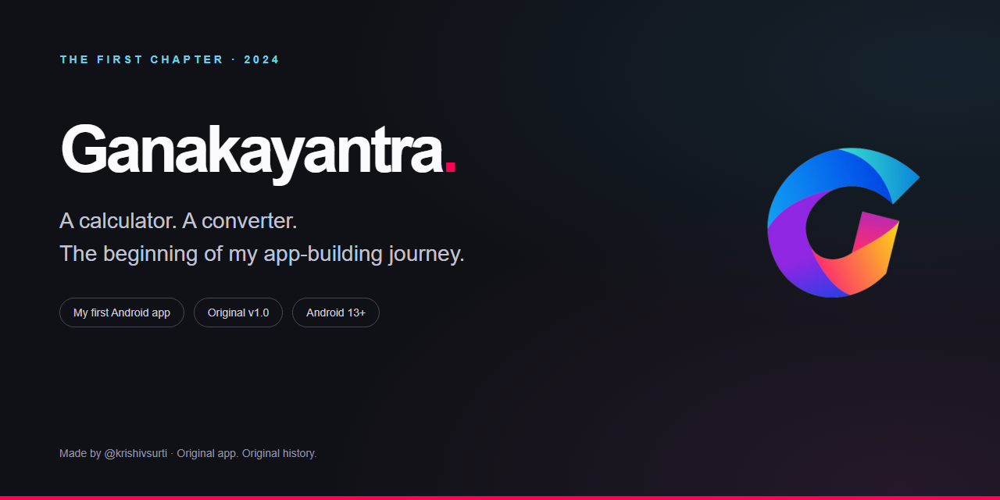
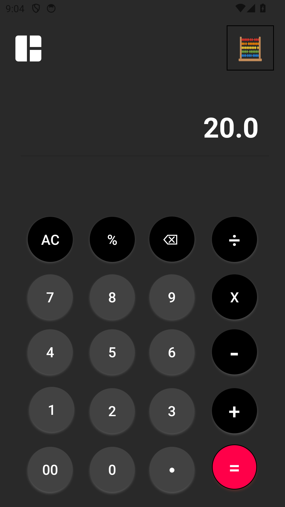
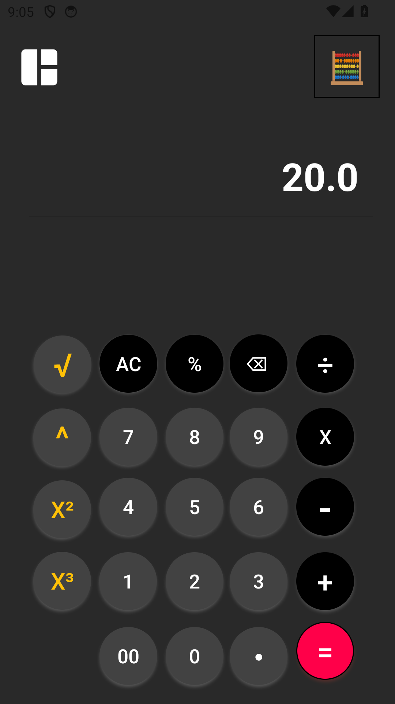
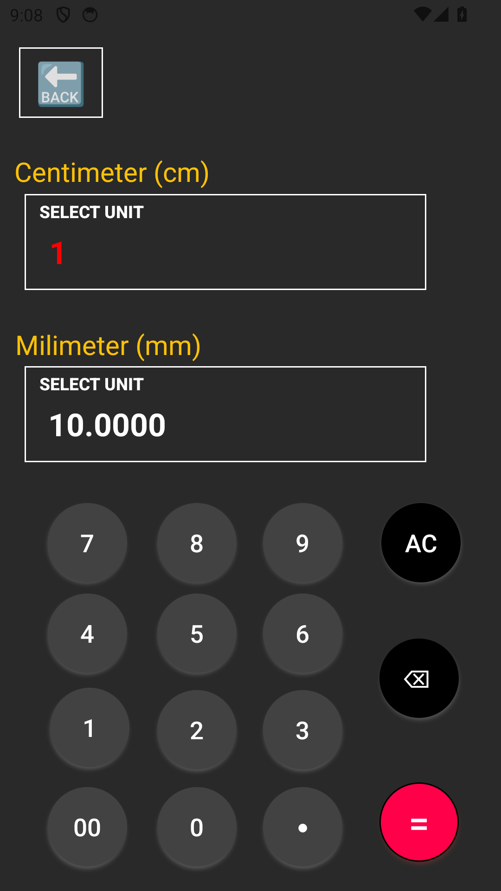

<strong>A calculator. A converter. The beginning of my app-building journey.</strong>

  

## Every journey has a first build

**Ganakayantra is the first app I made myself.** It brings everyday calculations and length conversion into a simple Android application, with an expanded calculator panel for additional operations.

This repository preserves that first milestone: the original APK and the project's history dating back to **October 2024**. The presentation has been refreshed; the app itself has not been rebuilt or changed.

> **Showcase and downloads only.** Application source code, Firebase configuration, signing keys and private project files are not distributed here.

## See the original app

<table>
<tr><th>Everyday calculator</th><th>Expanded calculator</th><th>Length conversion</th></tr>
<tr>
<td width="33%"></td>
<td width="33%"></td>
<td width="33%"></td>
</tr>
</table>

Screenshots were captured from the unchanged original APK running on an Android emulator.

## What it does

| Feature | In the original app |
| --- | --- |
| Everyday arithmetic | Addition, subtraction, multiplication and division |
| Calculator controls | Percentage, decimal input, clear and backspace |
| Expanded panel | Root, power, square and cube controls |
| Length conversion | Select source and target units, enter a value and convert |
| Unit selection | A range of length units, including metric and astronomical choices |
| Appearance | Dark interface with round controls and a bright accent |

The showcase review checked **12 + 8 = 20** and **1 cm = 10 mm**. These are smoke checks, not a claim that every numerical edge case has been tested.

## Download and try it

**[Download Ganakayantra v1.0](https://github.com/krishivsurti/Ganakayantra/releases/latest)**

1. Open the release page and download `Ganakayantra-v1.0.apk`.
2. Open the APK on an Android 13+ device and allow installation from that download source if prompted.
3. Launch **Ganakayantra**. Explore the calculator, expanded panel and **More Features → Unit Conversion**.

### Original build details

| Detail | Value |
| --- | --- |
| App name | Ganakayantra |
| Original version | 1.0 · version code 1 |
| Minimum Android version | Android 13 · API 33 |
| Package | `com.example.ganakayantra` |
| Distribution | Original debug-signed APK, preserved as built |
| APK SHA-256 | `172423097df769ce3bdd42025a1f7ebfe5cf570b36fd50fcbdbccd78c8c16bc8` |

The original [`app-debug.apk`](app-debug.apk) remains in the repository. The release asset is a friendlier filename for the same bytes, not a newly signed app or a new version.

## A small piece of my story

Ganakayantra is where I started learning how an idea becomes an app: arranging a screen, responding to a button, performing a calculation and seeing it work on a phone.

I am keeping this project as a record of that first step, alongside the work that followed. It is presented as my original first project, not as a newly rebuilt application.

## Feedback and collaboration

Have a suggestion, a usability observation or a memory of your own first project?

- [Report a reproducible bug](https://github.com/krishivsurti/Ganakayantra/issues/new/choose).
- [Suggest an improvement](https://github.com/krishivsurti/Ganakayantra/issues/new/choose).
- [Join the discussion](https://github.com/krishivsurti/Ganakayantra/discussions).

You can contribute feedback without accessing application source. Read the [contribution guide](CONTRIBUTING.md), and use [private reporting](SECURITY.md) for security concerns.

---

Made by [@krishivsurti](https://github.com/krishivsurti). First project, original history preserved. · [Privacy](PRIVACY.md) · [Copyright](LICENSE)
